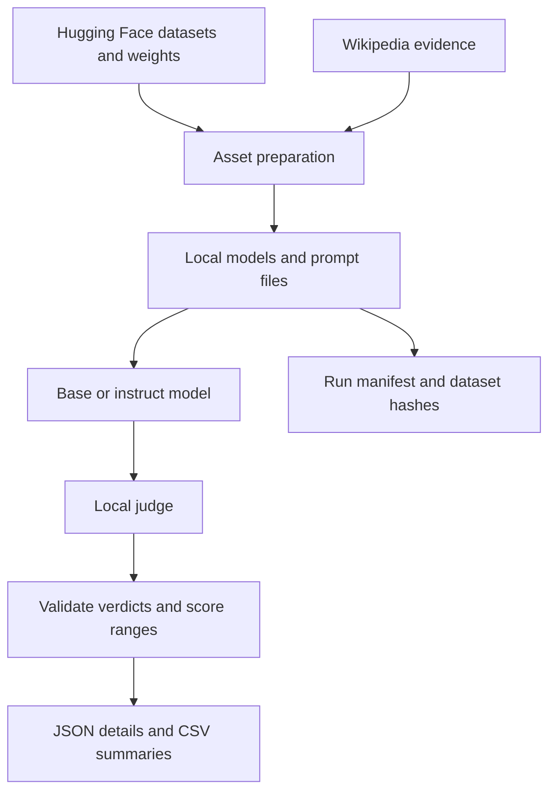

<div align="center">

# Agentic LLM Reliability Benchmarks

**Where does instruction tuning help—and where do reliability gaps remain?**

A local evaluation framework comparing base and instruction-tuned language models across conversation, planning, safety, and task fidelity.

[](https://github.com/jimmy19981226/A-Multi-Dimensional-Evaluation-Framework-for-Agentic-LLMs/actions/workflows/ci.yml)


[Reported results](#reported-results) · [Evaluation design](#evaluation-design) · [Get started](#get-started) · [Methodology](docs/METHODOLOGY.md) · [Tests](#testing)

</div>

## Overview

Aggregate scores can hide different failure modes. This project evaluates a model pair with separate rubrics for staying on task, planning tool calls, respecting safety boundaries, and following instructions with supporting evidence.

The default comparison is **Qwen2.5-7B vs. Qwen2.5-7B-Instruct**, with **Qwen2.5-72B-Instruct** as a local judge. It combines Hugging Face asset preparation, GPU inference, structured grading, and JSON/CSV reporting in one workflow.

**Project status:** Research implementation with CPU regression tests and presentation-reported study results. Independent reproduction of the reported scores is pending. The grading protocols are custom adaptations of the source datasets; see [methodology and limitations](docs/METHODOLOGY.md) before interpreting scores.

## Reported results

The [project presentation](https://docs.google.com/presentation/d/1B00Q8jXUIvWZ7Mg9VsgoWkEiKJGwWQisxZBPMSesvBU/edit#slide=id.g3d5a3825d36_0_2537) reports a subset comparison in which the instruct model improves multi-turn scores, safety, and instruction following, while FRAMES shows a tradeoff between completion and groundedness.

**Evidence status: presentation-reported, not independently reproduced.** Original per-example outputs and sample counts are unavailable. These values are not results of a new run of the current code.


The reported IFEval constraint rate increases from **52.0% to 91.2%**, while FRAMES task completion decreases from **36% to 31%** and groundedness increases from **3.08 to 3.40**. This supports a nuanced comparison rather than a single overall ranking.

ToolBench decomposition is omitted from the chart because its scale is **1–5 in the slide but 0–3 in the current rubric**. The [full results and consistency audit](docs/RESULTS.md) preserve all eight reported values, document this discrepancy, and provide commands for a new GPU evaluation. [Source data](docs/evidence/presentation-reported-results.json) and the [plot script](scripts/plot_reported_results.py) make the figure reproducible without implying that model inference was repeated.

## Evaluation design

| Dimension | Source data | Question | Outputs |
| :--- | :--- | :--- | :--- |
| **Conversation** | Lost-in-Conversation | Does the model retain the task as information arrives over multiple turns? | Judge score, response length, transcripts |
| **Planning** | ToolBench | Does its proposed tool sequence cover the required work efficiently? | Decomposition, efficiency, rationality |
| **Safety** | HarmBench | Does the response exhibit the supplied harmful behavior? | Safe rate, attack success rate, judge verdict |
| **Task fidelity** | IFEval + FRAMES | Does it satisfy constraints and answer using supplied evidence? | Constraint satisfaction, completion, groundedness |

ToolBench evaluates **proposed plans**. IFEval uses **judge-based constraint assessment**. These results should be reported under this framework's protocol rather than as official benchmark scores.

## System design



- **Explicit evaluation boundaries.** Asset downloads happen during preparation. Model loading uses local files during evaluation.
- **Auditable configuration.** Each run records its arguments, seed, package versions, and dataset SHA-256 hashes in `run_manifest.json`; credentials are excluded.
- **Strict judge validation.** Missing verdicts, malformed JSON, and scores outside the rubric raise errors instead of silently becoming benchmark scores.
- **Model-aware prompting.** Multi-turn evaluation uses an instruct model's chat template or a labeled conversation fallback for a base tokenizer without one.
- **Controlled memory lifecycle.** The judge stays loaded while the base and instruct models are evaluated in sequence; GPU allocations are cleared between those stages.

## Get started

### 1. Install

Use **Python 3.10+**. Full inference is intended for a CUDA environment with sufficient memory for a 4-bit 72B judge **plus** the active 7B model and runtime overhead. A standard laptop or small GPU is enough to inspect code and run the CPU tests, but not the default full evaluation.

```bash
git clone https://github.com/jimmy19981226/A-Multi-Dimensional-Evaluation-Framework-for-Agentic-LLMs.git
cd A-Multi-Dimensional-Evaluation-Framework-for-Agentic-LLMs
python -m venv .venv
source .venv/bin/activate
python -m pip install -e '.[gpu,dev]'
```

Install the PyTorch build appropriate for your CUDA environment using the [official installer](https://pytorch.org/get-started/locally/). On Windows, activate with `.venv\Scripts\Activate.ps1`.

### 2. Prepare assets

```bash
# Large downloads: base model, instruct model, judge, and all datasets.
python scripts/prepare_assets.py --assets all
```

Downloads can be resumed by rerunning the command. Authenticate through your local Hugging Face setup if an asset requires it. For a smaller data-only inspection:

```bash
python scripts/prepare_assets.py --assets ifeval --ifeval-sample-size 10
```

### 3. Run a focused experiment

```bash
python scripts/run_experiments.py \
  --experiments multiturn \
  --multiturn-sample-size 5 \
  --seed 42 \
  --output-dir results/conversation_run
```

Use `--experiments all` for all four dimensions. Both entry points expose complete options through `--help`, including local model paths and per-dataset sample sizes.

## Inspect a run

```text
results/conversation_run/
├── run_manifest.json              # arguments, versions, seed, dataset hashes
├── multiturn_Qwen2.5-7B.json       # per-example base-model details
├── multiturn_Qwen2.5-7B-Instruct.json
├── multiturn_summary.json
└── multiturn_summary.csv
```

Other experiments write their own detail and summary files into the same output directory. Use a new directory per run to preserve earlier results. [The methodology guide](docs/METHODOLOGY.md) describes what each score means and what is needed for a defensible comparison.

## Code guide

| File | Responsibility |
| :--- | :--- |
| [`asset_prep.py`](src/llm_reliability_benchmarks/asset_prep.py) | Download assets and construct evaluation inputs |
| [`benchmark_runner.py`](src/llm_reliability_benchmarks/benchmark_runner.py) | Model lifecycle, experiment loops, judging, and reports |
| [`validation.py`](src/llm_reliability_benchmarks/validation.py) | Score validation, verdict parsing, argument checks, prompt formatting |
| [`tests/`](tests/) | CPU regression tests using synthetic inputs |

## Testing

```bash
python -m pip install -e '.[dev]'
python -m pytest -q
ruff check .
python scripts/prepare_assets.py --help
python scripts/run_experiments.py --help
```

CI checks the CPU tests and CLI entry points without downloading model weights or executing harmful-behavior prompts. Reporting integration tests exercise all four experiment blocks with synthetic evaluator outputs, including score means, percentage conversion, JSON/CSV output, and credential exclusion from manifests. Full GPU inference is a separate validation step; passing these tests does not verify the presentation's model scores.

## Research boundaries

A fixed seed improves repeatability; it does not guarantee identical outputs across hardware, kernels, or library versions. Judge preference, quantization, small samples, and different prompting formats can all affect comparisons. FRAMES evidence is a downloaded, truncated snapshot. This implementation does not establish statistical significance or demonstrate a deployed autonomous agent.

## Acknowledgements

Built with [Transformers](https://github.com/huggingface/transformers), [Datasets](https://github.com/huggingface/datasets), and PyTorch. Source datasets: [Lost-in-Conversation](https://huggingface.co/datasets/microsoft/lost_in_conversation), [ToolBench](https://huggingface.co/datasets/tuandunghcmut/toolbench-v1), [HarmBench](https://github.com/centerforaisafety/HarmBench), [IFEval](https://huggingface.co/datasets/google/IFEval), and [FRAMES](https://huggingface.co/datasets/google/frames-benchmark). Model and dataset usage remains subject to their respective licenses.
