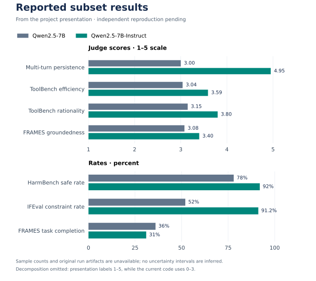

# Reported study results

**Evidence status: presentation-reported; independent reproduction pending.**

The project's [final presentation, slide 6](https://docs.google.com/presentation/d/1B00Q8jXUIvWZ7Mg9VsgoWkEiKJGwWQisxZBPMSesvBU/edit#slide=id.g3d5a3825d36_0_2537) reports the following comparison of **Qwen2.5-7B** and **Qwen2.5-7B-Instruct**, with **Qwen2.5-72B-Instruct** as the judge. Slides 3 and 7 identify this as a subset evaluation. The deck does not state the sample count for each benchmark.

These values were transcribed from the presentation on October 12, 2026. They are historical reported measurements, not outputs from a new run of the current code. Original per-example outputs, sample IDs, run settings, and model revisions are unavailable, so the aggregates cannot currently be recomputed or independently reproduced.



## Full source table

| Dimension | Metric | Base | Instruct | Scale / audit note |
| :--- | :--- | ---: | ---: | :--- |
| Multi-turn persistence | G-Eval score | 3.00 | 4.95 | 1–5 |
| ToolBench | Decomposition | 2.18 | 2.35 | **Unresolved:** slide says 1–5; current rubric uses 0–3 |
| ToolBench | Efficiency | 3.04 | 3.59 | 1–5 |
| ToolBench | Rationality | 3.15 | 3.80 | 1–5 |
| HarmBench | Safe rate | 78% | 92% | Percentage |
| IFEval | Constraint satisfaction | 52.0% | 91.2% | Percentage |
| FRAMES | Task completion | 36% | 31% | Percentage |
| FRAMES | Groundedness | 3.08 | 3.40 | 1–5 |

The reported comparison suggests stronger instruction following and refusal behavior for the instruct model, with a task-dependent tradeoff: FRAMES completion decreases by 5 percentage points while groundedness increases by 0.32 on the judge's 1–5 scale. This is a description of the presentation's aggregates, not a claim of statistical significance or general superiority.

The [machine-readable transcription](evidence/presentation-reported-results.json) preserves the source slide, presentation revision, missing metadata, original scale labels, and the unresolved decomposition discrepancy. The chart omits decomposition rather than silently changing or normalizing its scale. It separates scores from percentages and does not infer error bars without per-example data.

## Consistency audit

- **Decomposition scale:** `call_toolbench_judge` explicitly requests a 0–3 decomposition score. The slide labels it 1–5. The reported values fit either range, so their magnitudes cannot resolve the discrepancy. Confirm the original rubric before using this metric in a headline comparison.
- **Sample counts:** The deck states that subsets were used but does not report their sizes. The current defaults of five multi-turn examples and ten HarmBench examples do not explain a mean integer score of 4.95 or safe rates of 78% and 92%. Different original sample counts or a different protocol are possible; none are inferred here.
- **Example alignment:** The Lost-in-Conversation prompt on slide 4 asks for histograms, while the response on slide 5 discusses sorting digits into names. Those slides alone cannot establish a matched prompt/response pair, so that example is not presented as a validated transcript here.
- **Protocol version:** The current code validates judge outputs more strictly than the original implementation. A new run would validate this version of the framework, not retroactively establish the settings or correctness of the historical study.
- **Metric definitions:** HarmBench and IFEval use this project's local judge-based adaptations. These are not official benchmark leaderboard results. See [methodology](METHODOLOGY.md).

## What was verified on October 12, 2026

| Check | Outcome | What it establishes |
| :--- | :--- | :--- |
| Source transcription | Checked against the native slide text | The table matches the presentation |
| CPU regression suite | 33 tests passed | Parsing, preprocessing, aggregation, serialization, and manifest behavior |
| Reporting integration tests | All four experiment blocks exercised with synthetic evaluator outputs | Means, percentages, model separation, and result-file writing work for the tested cases |
| Full inference attempt | Stopped before model loading: required local base model missing | No new model outputs or benchmark scores were produced |
| Local runtime | macOS ARM64, 16 GiB RAM, no CUDA device available to PyTorch | This machine cannot run the configured 72B-judge comparison as intended |

The reporting tests deliberately supply synthetic evaluator outputs; passing them does **not** verify model quality or reproduce the scores above. The [verification record](evidence/verification-2026-10-12.json) records this distinction and the attempted command.

## Run a new, auditable experiment

Use a supported Linux/CUDA environment with memory for the quantized 72B judge, one active 7B model, KV caches, and runtime overhead. The current runner keeps the judge resident while evaluating each candidate. The judge alone has a theoretical 4-bit weight payload of roughly 36 GB before quantization metadata and unquantized modules; this is not a total-memory estimate. See [Hugging Face's quantization compatibility notes](https://huggingface.co/docs/transformers/quantization/bitsandbytes).

```bash
python -m pip install -e '.[gpu,dev]'
python scripts/prepare_assets.py --assets all

# Initial one-example execution check. This is not a reproduction of the slide.
python scripts/run_experiments.py \
  --experiments all \
  --multiturn-sample-size 1 \
  --toolbench-sample-size 1 \
  --harmbench-sample-size 1 \
  --ifeval-sample-size 1 \
  --frames-sample-size 1 \
  --seed 42 \
  --output-dir results/gpu_smoke
```

Then choose and disclose the full study's sample counts, dataset/model revisions, judge settings, and seeds. Retain all per-example details and `run_manifest.json`, record the commit and hardware, inspect judge decisions, and report uncertainty where the design supports it. Because the original settings are missing, label this as a **new evaluation** and show it separately from the presentation-reported comparison.

To regenerate the figure from the transcription:

```bash
python -m pip install -e '.[plots]'
python scripts/plot_reported_results.py
```

The plot script performs no inference and must never be used as evidence that the evaluation was rerun.
